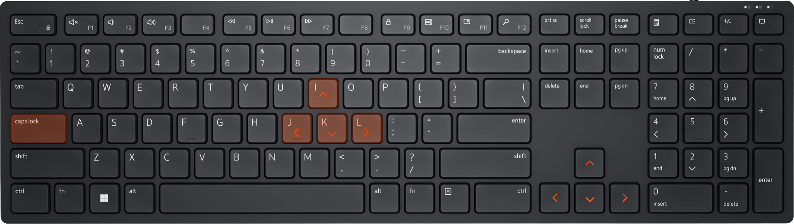

# arrowkeys

**Move through text without reaching for the arrow keys.** Hold **Caps Lock** and use **J K L I** to move left, down, right and up. Jump by word or go to the start and end of a line with the nearby keys.

A small [AutoHotkey v2](https://www.autohotkey.com/) script for Windows: one file, eight navigation shortcuts, and your existing arrow keys still available.

## Try it in a minute

1. Install [AutoHotkey v2](https://www.autohotkey.com/).
2. Choose **Code → Download ZIP** in this repository and extract it to a permanent folder.
3. Double-click [`arrowkeys.ahk`](arrowkeys.ahk). An AutoHotkey icon appears in the system tray.
4. Open a text editor, type a line, then hold **Caps Lock** and tap **J** to move left. Release Caps Lock and type normally.

**Requirements:** Windows and **AutoHotkey v2.0 or a later v2 release**, as specified by `#Requires AutoHotkey v2.0`. AutoHotkey v1 is incompatible. The current script was tested with **AutoHotkey v2.0.18**.

## The keys

Hold **Caps Lock** while pressing a key below. Holding a navigation key repeats its action.

| Shortcut | Sends | Use it to… |
| --- | --- | --- |
| Caps Lock + **J** | Left arrow | Move one character left |
| Caps Lock + **K** | Down arrow | Move down |
| Caps Lock + **L** | Right arrow | Move one character right |
| Caps Lock + **I** | Up arrow | Move up |
| Caps Lock + **U** | Home | Go to the start of a line |
| Caps Lock + **O** | End | Go to the end of a line |
| Caps Lock + **H** | Ctrl + Left arrow | Jump to the previous word |
| Caps Lock + **;** | Ctrl + Right arrow | Jump to the next word |

For example, when correcting a sentence, hold Caps Lock and tap **H** to move back a word, release Caps Lock to edit, then use **O** with Caps Lock to return to the end of the line. In code, **U** and **O** help reach the start or end of a line without moving to the navigation cluster. The receiving app determines the exact behavior of Home, End and word movement.

### Caps Lock acts as Alt

The script uses `CapsLock::Alt`: Caps Lock becomes an **Alt modifier**, including for other Alt shortcuts in your app. A single Caps Lock press sends an **Alt press and release**, which can activate an application's menu. It does **not** toggle uppercase typing.

The navigation shortcuts are defined as **Alt + key**, so the physical Alt key also triggers them. Plain J, K, L, I and the other letters continue to work normally when Caps Lock and Alt are released.

Extra Ctrl or Shift modifiers change which hotkey matches; additional selection shortcuts are not defined. Letter and punctuation bindings depend on the keyboard layout. For example, on a Russian layout, `;` may require **Shift + 4**.

## Keep it running at sign-in

1. Create a shortcut to `arrowkeys.ahk` in its permanent folder.
2. Press **Win + R**, enter `shell:startup`, and press **Enter**.
3. Put the **shortcut** in the Startup folder.

Windows will launch it when you sign in. Keep the script in place so the shortcut continues to work; using a shortcut also means you only have one copy to update.

## Reload or stop

- **After editing:** right-click the AutoHotkey tray icon and choose **Reload Script**. Launching the same script again also replaces its earlier instance through `#SingleInstance Force`.
- **Stop and restore the usual key behavior:** right-click the tray icon and choose **Exit**. Caps Lock can then be used as its normal toggle again.
- **Stop automatic startup:** remove its shortcut from the Startup folder, then exit the running script.

Use **Exit** when you want the Caps Lock safeguard to stop too; suspending hotkeys alone does not stop the timer.

## Caps Lock safeguard and limits

Since Caps Lock is used as Alt, its uppercase toggle is kept **off** while this script runs. `SetCapsLockState "AlwaysOff"` applies at startup. A small check every **250 ms** also switches it off if another script or a synthetic keyboard event enables it despite that setting. The check only changes the Caps Lock toggle; it does not release held modifiers or change the navigation bindings.

The correction normally runs on the next timer tick. A busy or suspended process can delay it, and other keyboard hooks or remapping tools can still interfere. This is a recovery measure for an unintended toggle, not a guarantee against every possible input fault.

The update was checked with synthetic input across **44 before/after navigation scenarios** and **three forced-toggle scenarios**, including repeat, modifier combinations, release order and focus changes. These checks do not establish the source of every rare fault or test physical hardware failures.

Some apps, games and elevated windows handle simulated input differently. Use the script in your usual apps to check compatibility. It sends ordinary navigation keys and does not change keyboard drivers or registry mappings.

## Contributing

Suggestions and fixes are welcome. For a keyboard issue, include your AutoHotkey version, keyboard layout, affected app, other remapping tools, and the order in which you press and release the keys. Avoid including private text or clipboard contents.

## License

[MIT](LICENSE).
