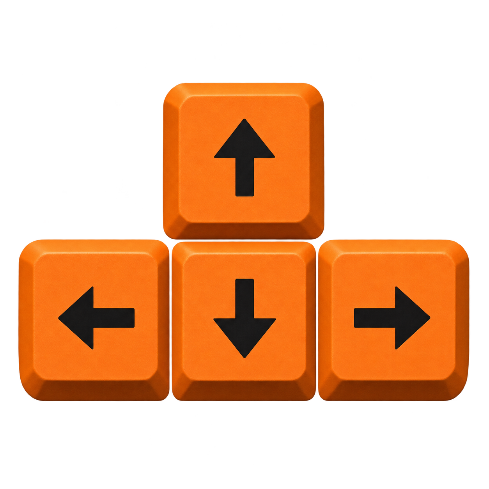
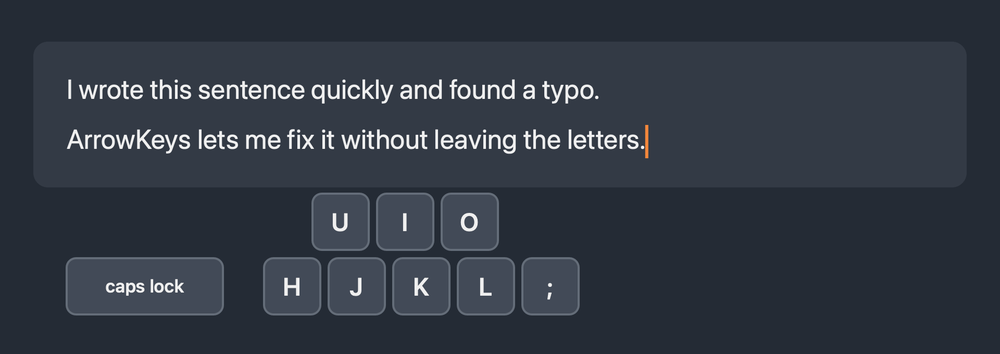
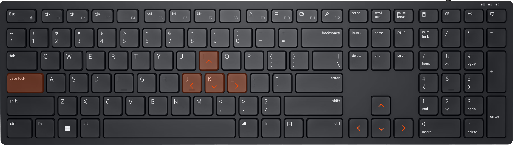
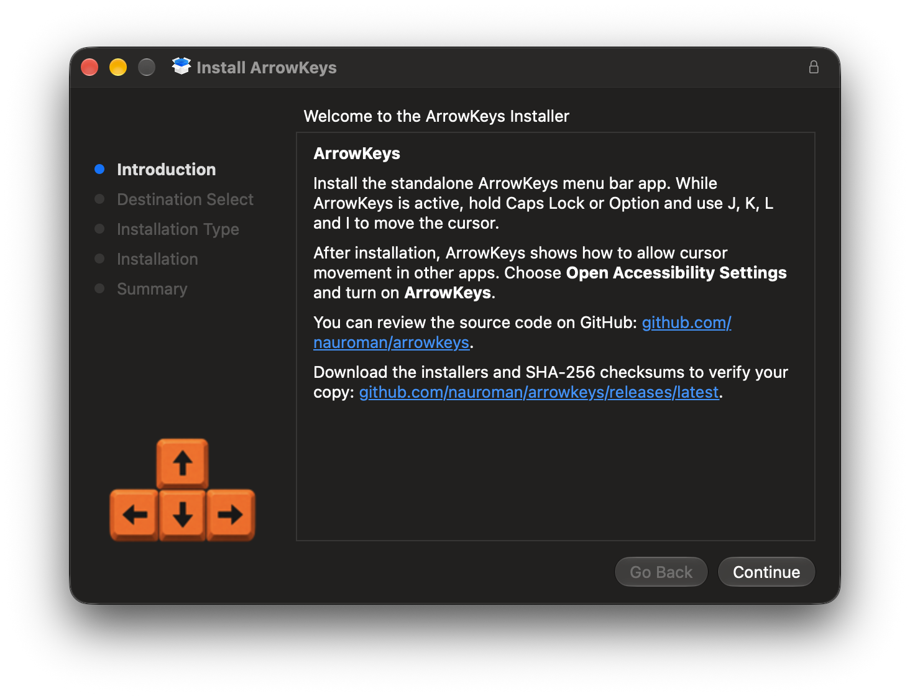
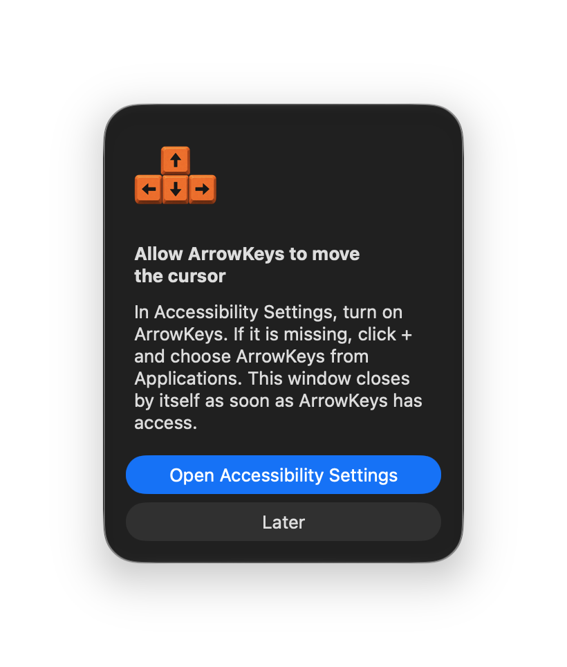
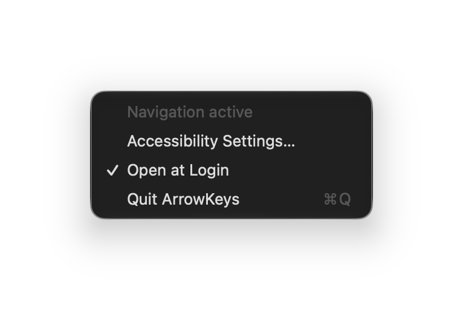

#  ArrowKeys

**Move the text cursor without taking your hands off the letters.** Hold **Caps Lock** and press **J K L I** to move left, down, right and up. ArrowKeys is free, works offline, and runs on Mac and Windows.

**Website:** [nauroman.github.io/arrowkeys](https://nauroman.github.io/arrowkeys/)



[](https://github.com/nauroman/arrowkeys/actions/workflows/build.yml)

## Why use it

When you type, your fingers rest on the middle row of letters. The arrow keys sit in the far corner of the keyboard, and many laptop and compact keyboards make them tiny. Every time you fix a typo or move to another word, you reach over, look down, and find your place again.

ArrowKeys puts the arrows under your right hand instead. **Caps Lock** is right next to your left little finger and most people rarely use it. ArrowKeys turns it into a navigation key, much as **Shift** turns letters into capitals:

1. Hold **Caps Lock** with your left little finger.
2. Press **J**, **K**, **L** or **I** with your right hand. The cursor moves as if you had pressed an arrow key.
3. Let go of Caps Lock and keep typing.

This helps anyone who writes a lot: emails, documents, chats or code. People who know touch typing get the most out of it.

## Shortcuts

Hold **Caps Lock** and press:

| Key | Moves the cursor | Like pressing |
| --- | --- | --- |
| **J** | One letter left | ← |
| **L** | One letter right | → |
| **I** | One line up | ↑ |
| **K** | One line down | ↓ |
| **H** | Back one word | Option + ← on Mac, Ctrl + ← on Windows |
| **;** | Forward one word | Option + → on Mac, Ctrl + → on Windows |
| **U** | To the start of the line | Command + ← on Mac, Home on Windows |
| **O** | To the end of the line | Command + → on Mac, End on Windows |

Holding a key repeats it, just like a real arrow key. The highlighted keys show where they are:



**What happens to Caps Lock?** While ArrowKeys is running, Caps Lock no longer switches to capital letters. Use **Shift** for capitals as usual. Quit ArrowKeys and Caps Lock works as before.

## Install on a Mac

ArrowKeys needs macOS 13 or newer and works on Apple silicon and Intel Macs. The download is about 1 MB.

**1. Download and open the installer.** Download [**ArrowKeys-macOS.pkg**](https://github.com/nauroman/arrowkeys/releases/latest/download/ArrowKeys-macOS.pkg) and double-click it. Choose **Continue**, then **Install**, and enter your Mac password when asked. The package is signed by the developer and checked by Apple, so it opens without warnings.



**2. Allow ArrowKeys to move the cursor.** ArrowKeys starts by itself after installation. For it to move the cursor in other apps, macOS needs your permission in **Accessibility** settings. ArrowKeys shows this window:



Choose **Open Accessibility Settings** and turn on the switch next to **ArrowKeys**. The ArrowKeys window closes by itself as soon as access is on.

**3. Check the menu bar.** ArrowKeys lives in the menu bar at the top of the screen. It has no window or Dock icon. Click its four-arrow icon to see its menu:



**Navigation active** means everything is ready. Open any text, hold **Caps Lock** and press **J**. The cursor moves one letter left.

ArrowKeys starts automatically when you log in. To change that, click **Open at Login** in the menu. It also works on every connected keyboard, including keyboards you plug in or pair later.

### Update or remove it on a Mac

- **Update:** download the new package and install it over the old one. Updates keep the Accessibility permission. Updating from version 1.1.4 or older is the one exception: turn ArrowKeys on in Accessibility settings once more.
- **Remove:** choose **Quit ArrowKeys** in its menu, then move **ArrowKeys** from the **Applications** folder to the Trash. Caps Lock goes back to how it was.

## Install on Windows

The easiest way is **[Arrow Keys in the Microsoft Store](https://apps.microsoft.com/detail/9NTNKTVCJ1J1)**. Install it and open it once. It starts automatically when you sign in.

You can also download [**ArrowKeys-Windows-Setup.exe**](https://github.com/nauroman/arrowkeys/releases/latest/download/ArrowKeys-Windows-Setup.exe) and run it. This installer has no publisher signature, so Windows may show **Windows protected your PC**. Choose **More info**, then **Run anyway**. Or use the Microsoft Store version, which does not show this warning.

After installation, open any text, hold **Caps Lock** and press **J**. To remove ArrowKeys, uninstall it in **Settings → Apps → Installed apps**.

## Questions

**The cursor doesn't move. What should I check?** On a Mac, click the four-arrow icon in the menu bar. If the menu does not say **Navigation active**, choose the item at the top and follow the steps. Some apps, games and windows running as administrator on Windows may ignore simulated keys.

**The Accessibility switch is on, but ArrowKeys still asks for access.** Choose **Accessibility Settings…** in the ArrowKeys menu to open the list of apps. Select ArrowKeys and click **−**. Then click **+**, add **ArrowKeys** from **Applications**, and turn it on.

**Can I still type capital letters?** Yes, with **Shift**. Only the Caps Lock toggle is turned off while ArrowKeys runs.

**Is it safe to give ArrowKeys Accessibility access?** macOS asks for this permission for any app that presses keys for you. ArrowKeys only reacts to its eight shortcuts. It does not record what you type, collect data or connect to the internet. The [source code](macos/ArrowKeys.m) is public, and every release is built on GitHub from that code and scanned for viruses. See the [privacy policy](PRIVACY.md).

**Does it work with my keyboard layout?** ArrowKeys uses key positions, not letters. On a Mac, the shortcuts stay on the same physical keys even with a Russian or another layout. On Windows, letter keys depend on the layout, so on a Russian layout **;** may be on a different key.

## More details

### Mac

Caps Lock acts as **Option**, so either physical Option key also works with the shortcuts. Holding a third key such as Shift leaves that combination to the app. A shortcut takes priority over the special character Option would normally type. ArrowKeys reads eight physical key positions through a macOS event tap. Other Option shortcuts, such as switching input sources with Option + Shift, pass through.

If the menu says **Keyboard connection unavailable — retrying**, macOS has granted access and ArrowKeys is reconnecting to the keyboard automatically. If the menu shows **Open at Login (Approval Required…)**, select it to open the macOS Login Items settings.

Quitting ArrowKeys, or moving the running app to the Trash, restores the previous Caps Lock assignment on each keyboard it changed. If you set Caps Lock to Option by hand for an older version, choose **Caps Lock** for that key in **System Settings → Keyboard → Keyboard Shortcuts… → Modifier Keys**. Switching from the old Karabiner-Elements edition? Remove its ArrowKeys rule in **Complex Modifications** so the shortcuts are not handled twice.

A separate sandboxed edition for the Mac App Store targets macOS 15.2 and later. [Build and test it](packaging/mac-app-store/README.md)

### Windows

The Windows edition is an [AutoHotkey v2](https://www.autohotkey.com/) script, [`arrowkeys.ahk`](arrowkeys.ahk). The installer includes AutoHotkey.

The script maps Caps Lock to **Alt** (`CapsLock::Alt`), so the physical Alt key also triggers the shortcuts. A single Caps Lock tap sends an Alt press and release, which can open an app's menu. Plain letters type normally when Caps Lock and Alt are released. Adding Ctrl or Shift does not select text.

The Caps Lock toggle is kept off with `SetCapsLockState "AlwaysOff"`. A check every 250 ms also switches it off if another program turns it on. This is a recovery measure, not a guarantee against every input fault. The script was checked with synthetic input across 44 navigation scenarios and three forced-toggle scenarios. These checks do not cover physical hardware faults.

**Run from source:**
1. Install [AutoHotkey v2](https://www.autohotkey.com/) (v2.0 or a later v2 release; v1 is incompatible).
2. Choose **Code → Download ZIP** and extract it to a permanent folder.
3. Double-click `arrowkeys.ahk`. An AutoHotkey icon appears in the system tray.
4. To start it at sign-in, press **Win + R**, enter `shell:startup`, and put a shortcut to `arrowkeys.ahk` in that folder.

To reload after editing, right-click the tray icon and choose **Reload Script**. Choose **Exit** to stop it and restore Caps Lock.

### Verify a download

The [release workflow](.github/workflows/build.yml) builds the installers from the tagged source, tests installation on Windows and macOS, and scans the downloads with ClamAV. Each release links to its scan log and includes **SHA256SUMS.txt**. A clean scan means the scanner found no known threats in those files at the time of the scan.

You can check that a download matches GitHub's signed build record with the [GitHub CLI](https://cli.github.com/):

```shell
gh attestation verify ArrowKeys-macOS.pkg --repo nauroman/arrowkeys
gh attestation verify ArrowKeys-Windows-Setup.exe --repo nauroman/arrowkeys
```

## Support ArrowKeys

ArrowKeys is free. If it saves you time, you can [leave a tip on Ko-fi](https://ko-fi.com/nauroman). It pays for the Apple developer membership and for time to keep ArrowKeys updated.

## Contributing

Suggestions and fixes are welcome in [Issues](https://github.com/nauroman/arrowkeys/issues). For a keyboard problem, include your system version, keyboard layout, the app where it happens, any other key remapping tools, and the order in which you press and release the keys. Please don't include private text.

## License

[MIT](LICENSE)
